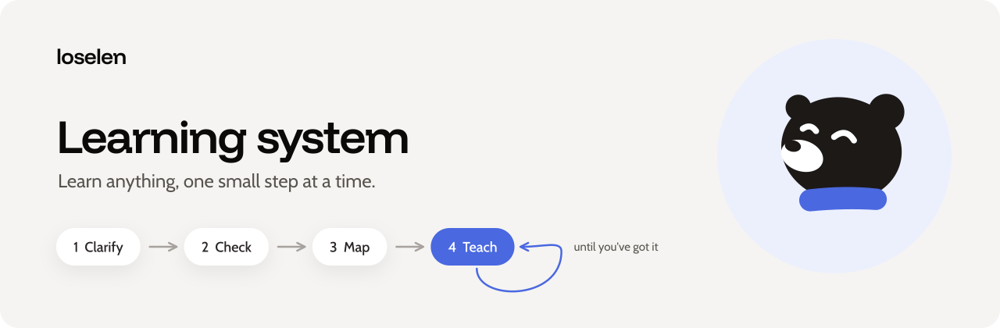

<p align="center">
  
</p>

<p align="center">
  
  
  <a href="LICENSE"></a>
</p>

<h3 align="center">Learn anything, one small step at a time.</h3>

A short explanation. One activity. You try it. The next step fits your attempt.

## Experimental.4

**Less bookkeeping, more learning.** SQLite stores notes, attempts, progress and session memory. Your agent reads only the context it needs and saves a turn in one transaction. No Markdown rewrites, graph updates or automatic summaries between activities.

This prerelease combines experimental.3 with stable 1.3.1's activity designer. Discovery and personalization remain available on request—not on every lesson. It is experimental, not a measured claim about model response speed. See [experimental.4](https://github.com/loselen/learn-anything/releases/tag/v1.4.0-experimental.4) and its validation limits before migrating real notes.

## Install

Install experimental.4 separately from stable:

```sh
npx skills add https://github.com/loselen/learn-anything/tree/v1.4.0-experimental.4 --all
```

The stable release remains separate:

```sh
npx skills add loselen/learn-anything
```

The open [SKILL.md format](https://agentskills.io) works with any compatible agent. You can also copy folders from `skills/` into its skills folder. For Claude Code, this repository includes a plugin marketplace. Prerelease packages, once published, are separate from stable/latest.

## Start learning

> Teach me recursion, quick start.

No interview or full roadmap required. Ask for a roadmap when you want one: clarify → draft → check → map, then teach and test.

For memory across sessions, open an agent in a dedicated learning folder and ask:

> Set up my learning memory here.

Python 3.10+ with SQLite is enough. No server or account. Without local execution, teaching works in chat, but cross-session persistence isn't guaranteed.

```text
my-learning/
├── AGENTS.md
├── CLAUDE.md
├── .learning/
│   ├── memory.sqlite3
│   ├── memory.py
│   ├── legacy.py
│   └── schema.sql
└── My Summary.md        only after you ask to summarize yourself
```

“Pause here”, “Resume”, “Save that question” and “What's due?” use the database directly. Responses and own-words notes remain yours, verbatim. Placement, supported practice and retained learning stay distinct.

## Summarize yourself

> Summarize me based on what I've learned and saved.

`summarize-me` writes root **`My Summary.md`**: demonstrated abilities, developing skills, goals and explicitly shared context, with evidence and uncertainty. It updates **only when requested**, never after a lesson, on startup, or during review. Earlier snapshots stay in the database.

## Optional Markdown view

Want browsable notes? Ask for an export to a new folder:

```sh
python .learning/memory.py export ../learning-snapshot
```

Open that snapshot in Obsidian if you like. Plans, lessons, tests, references and saved actions are exported; structured answer keys are omitted by default. Imported prose may still contain old keys—inspect before sharing. It is a one-way view: edits aren't synchronized back, existing files aren't overwritten, and teaching doesn't wait for exports. Existing `My Summary.md` is copied as-is.

For an older Markdown vault, ask “Migrate my learning vault to SQLite”. `update-learning` validates a dry run, preserves original notes and imports in one transaction. PyYAML is needed only for this migration. See [migration](skills/update-learning/references/migration.md).

## The skills

| Skill | Purpose |
|---|---|
| [clarify-goal](skills/clarify-goal/SKILL.md) | Find a reachable goal |
| [check-level](skills/check-level/SKILL.md) | Find current strengths and gaps |
| [map-topic](skills/map-topic/SKILL.md) | Build a requested roadmap |
| [teach-me](skills/teach-me/SKILL.md) | Teach one step, then wait |
| [make-activity](skills/make-activity/SKILL.md) | Make the target thinking necessary and visible |
| [test-me](skills/test-me/SKILL.md) | Test and review one question at a time |
| [research-it](skills/research-it/SKILL.md) | Check uncertain facts |
| [understand-me](skills/understand-me/SKILL.md) | Keep the next step manageable |
| [setup-learning](skills/setup-learning/SKILL.md) | Initialize local memory |
| [update-learning](skills/update-learning/SKILL.md) | Upgrade or import an older vault |
| [ask-memory](skills/ask-memory/SKILL.md) | Query notes and progress |
| [explore-next](skills/explore-next/SKILL.md) | Explore checked activities on request |
| [summarize-me](skills/summarize-me/SKILL.md) | Write your requested personal snapshot |

The old storage skill names were `setup-obsidian`, `update-vault` and `ask-obsidian`; replace those installed folders when upgrading. Historical releases and their packages are unchanged.

## Details

- [Architecture and schema](docs/sqlite-memory.md)
- [Memory API](skills/setup-learning/references/api.md)
- [Experimental.4 validation](evals/results-sqlite.md)
- [Contributing](AGENTS.md)

Memory stays local; model-provider processing is separate. SQLite, backups and exports aren't encrypted. No analytics or background sync.

[MIT](LICENSE) · Made by loselen
