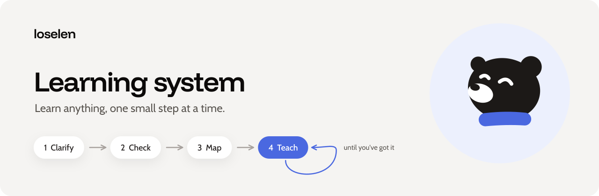
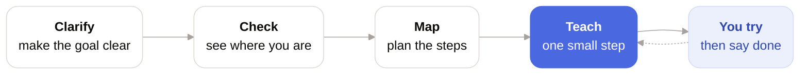
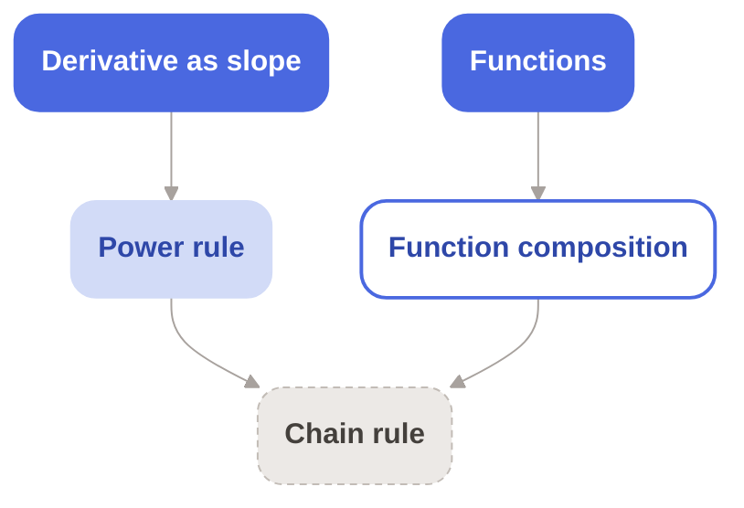

<p align="center">
  
</p>

<p align="center">
  
  
  <a href="LICENSE"></a>
</p>

<h3 align="center">Learn anything, one small step at a time.</h3>

<p align="center">7 skills that turn your agent into a patient teacher.</p>

---

## Why

A long lesson is easy to skim and easy to forget.

These skills teach the way a good tutor does. They find out what you want, check where you are, and start just above your level. You try something after every step. The next step fits what you did.

## How it works



1. **Clarify.** "Get better at statistics" becomes "read a regression table." Too far for now? You get a closer first goal, and the big one stays on the path.
2. **Check.** A few quick tries show what you know, what's shaky, and what's next.
3. **Map.** Your plan, starting where you are.
4. **Teach.** A short explanation and 1 activity, then a pause. You try it and say **done**. The next step adapts to you, until you've got it.

## What it feels like

> **You:** I want to write a function that walks a folder tree.
>
> **Agent:** Quick guess first. What does this print? *(4 lines of code)*
>
> **You:** 3, 2, 1?
>
> **Agent:** Close, it prints 1, 2, 3. Here's why… *(short explanation)*
> **Your turn:** write `countdown(n)`. Say **done** when you've tried.
>
> **You:** done
>
> **Agent:** Your base case is right. The print comes after the call, so the order flips. Let's fix that…

## The skills

| Skill | What it does |
|---|---|
| [`clarify-goal`](skills/clarify-goal/SKILL.md) | Makes your goal clear and reachable |
| [`check-level`](skills/check-level/SKILL.md) | Finds what you know, and why mistakes happen |
| [`map-topic`](skills/map-topic/SKILL.md) | Plans the steps, starting where you are |
| [`teach-me`](skills/teach-me/SKILL.md) | Teaches 1 step at a time, then waits for you |
| [`test-me`](skills/test-me/SKILL.md) | Tests what you've learned, then plans the retest |
| [`setup-obsidian`](skills/setup-obsidian/SKILL.md) | Sets up your vault, once |
| [`ask-obsidian`](skills/ask-obsidian/SKILL.md) | Answers questions about your vault |

Just ask: "teach me recursion", "what should I learn first?", "test me on recursion", "what's due this week?" Your agent picks the right skill.

## Install

The skills use the open [SKILL.md format](https://agentskills.io), so they work with any agent that reads it.

**Any agent**

```sh
npx skills add loselen/learn-anything
```

Pick your agents when asked. To install everything without prompts, add `--all`.

<details>
<summary><b>Claude Code plugin</b></summary>

```
/plugin marketplace add loselen/learn-anything
/plugin install learn-anything@learn-anything
```

</details>

<details>
<summary><b>Claude apps</b></summary>

Download the `.skill` files from the [latest release](https://github.com/loselen/learn-anything/releases/latest), then upload them in your skill settings.

</details>

<details>
<summary><b>By hand</b></summary>

Copy the folders in `skills/` into your agent's skills folder.

</details>

## Save your progress (optional)

No vault? Everything stays in the chat. With an Obsidian vault, your plans and lessons stay, and your agent picks up where you left off.

```
your-vault/
├── AGENTS.md           rules for your agent
├── CLAUDE.md           points Claude Code to AGENTS.md
├── Dashboard.base      what's due, what's next
├── Maps/               1 plan per topic
├── Lessons/            1 note per step
├── Tests/              1 note per test
├── Sources/
├── Templates/
└── Archive/
```

Each map shows your progress. Here, the goal is the chain rule:



| Look | Status |
|---|---|
| Solid blue | Solid |
| Light blue | Shaky, learned recently |
| Blue outline | Ready next |
| Grey, dashed | Not yet |

Each lesson grows 1 step at a time: the explanation, the activity, **your attempt**, and feedback. Your attempts, your test answers and your own-words summary stay yours. Your agent only saves what you share in chat, word for word.

**Set up once.** Open your agent in your vault folder and ask:

> Set up my learning vault.

Your agent adds the folders, the rules, the templates and the dashboard. From then on, every skill saves to your vault on its own.

Your agent needs access to the vault folder. Without it, you get files to copy in.

## Built on research

| Idea | From | Used in |
|---|---|---|
| Describe goals by what you'd see | Mager, goal analysis | `clarify-goal` |
| Teach just above your level | Vygotsky, zone of proximal development | `clarify-goal` |
| Skills build on skills | Gagné, learning hierarchies | `map-topic` |
| Place learners by what they can solve | Doignon & Falmagne, knowledge spaces | `check-level` |
| Think aloud, explain later | Ericsson & Simon, verbal reports | `check-level` |
| Mistakes follow rules | Brown & Burton, procedural bugs | `check-level` |
| Teach, check, correct, repeat | Bloom, mastery learning | `teach-me` |
| Show it, then let them try | Merrill, first principles of instruction | `teach-me` |
| Feel capable, free and supported | Ryan & Deci, self-determination theory | `teach-me` |
| Curiosity starts with a gap | Loewenstein, information gaps | `teach-me` |
| Write questions by skill and level | Krathwohl, revised Bloom's taxonomy | `test-me` |
| Testing beats rereading | Roediger & Karpicke, test-enhanced learning | `test-me` |
| Answer, then see feedback | Kang, McDermott & Roediger, test format and feedback | `test-me` |
| Use results to shape the next step | Black & Wiliam, formative assessment | `test-me` |

## Contribute

Issues and pull requests are welcome. See [`AGENTS.md`](AGENTS.md) for the rules. Your agent can follow them too.

Check your changes:

```sh
pip install skills-ref
for d in skills/*/; do agentskills validate "$d"; done
```

## License

[MIT](LICENSE) · Made by loselen
