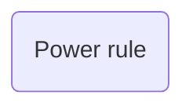

# Scratch artifact snapshots

Snapshots produced by the roleplays; capability IDs here are evaluator fixtures, not user data.

## Case 01 · Tests/Arithmetic test.md

````markdown
---
lessons: ['[[Addition]]', '[[Multiplication]]']
date: 2026-11-05
purpose: delayed review
coverage: {addition: [q1, q2], multiplication: [q3, q4]}
---
## Blueprint
Addition: q1, q2. Multiplication: q3, q4. Keys calculated independently.
## Questions
### Q1
1 + 1? (1 mark)
> [!success]- Answer
> 2
### Q2
3 + 4? (1 mark)
> [!success]- Answer
> 7
### Q3
2 * 3? (1 mark)
> [!success]- Answer
> 6
### Q4
2 * 1? (1 mark)
> [!success]- Answer
> 2
## My answers
### Q1
2
### Q2
idk
### Q3
5
### Q4
3
## Results
### Q1
1. Independent correct retrieval.
### Q2
0. Skipped retrieval; no independent evidence. Explanation offered.
### Q3
0. Wrong answer; multiplication not demonstrated. Explanation offered.
### Q4
0. Wrong answer on easier remaining item.
### Summary
Addition 1/2, multiplication 0/2. Addition exposure/skip requires a fresh replacement before completed review. Multiplication failed complete review: learning, repair true, interval 3. No global mastery claim.

````

## Case 04 · Lessons/Power rule.md

````markdown
---
capability_id: cap-power
status: review
placement: demonstrated
retention: unmeasured
interval: 3
next_review: 2026-11-08
---
## Level checks
2026-11-05: independent 3x² and 20x³; placement demonstrated.

````

## Case 04 · Maps/Calculus.md

````markdown
## Map


````

## Case 06 · Lessons/Recursion.md

````markdown
## Cycle 1 · 2026-11-05
### Activity
```python
def walk(n):
    if n == 0: return
    walk(n-1)
    print(n)
walk(2)
```
> [!success]- Answer
> 1, then 2. Verified by Python execution, unit recursion-1 v1.
### My attempt
1 then 2
### Analysis
Independent correct prediction; no transfer claim.

````

## Case 08 · Lessons/Personal.md

````markdown
---
status: learning
---
My exact personal note.  

````

## Case 12 · Lessons/Differentiate powers.md

````markdown
---
capability_id: 0b93f331-84ef-48c4-bf12-8b48a2fe1486
topic: ["[[Calculus]]", "[[Physics]]"]
---
## Evidence
attempt-1: 3x²

````

## Case 12 · Maps/Calculus.md

````markdown
[[Differentiate powers]]

````

## Case 12 · Maps/Physics.md

````markdown
[[Differentiate powers]]

````

## Case 14 · Sessions/Pending.md

````markdown
operation: delivery-1
expected: old
phase: evidence-written

````

## Case 17 · Sessions/Current.md

````markdown
---
session_id: s17
mode: continue
budget_minutes: 5
active_unit_id: recursion-two-call-v1
prompt_reference: "[[Recursion#Activity]]"
closure: paused
---
## Saved next action
Answer the saved two-call prediction.

````

## Case 17 · Sessions/Questions.md

````markdown
## q17
Question: How does recursion walk folders?
Origin: recursion-two-call-v1
Capability: cap-recursion
Disposition: saved

````

## Case 19 · Sessions/Current.md

````markdown
---
closure: closed
active_unit_id: recursion-two-call-v1
---
## Demonstrated progress
No independent attempt yet; example viewed.
## Saved next action
Predict the two-call output.

````

## Case 20 · Lessons/Custom.md

````markdown
---
status: learning
custom: "keep: exact"
schema_version: 2
capability_id: 21be241b-7d50-4af3-97ef-d9289816de5b
placement: unknown
retention: unmeasured
repair: false
prerequisite_groups: []
---
## My attempt

  My words, exactly.  

````

## Case 21 · Tests/Dispute.md

````markdown
## Assessment a21
Disputed; no lesson transition.
## Superseding assessment a21-correction
Python output 1 then 2 confirmed; earlier key incorrect.

````
